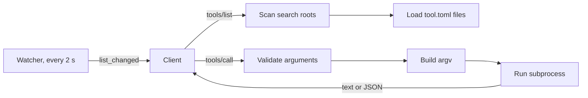

# agent-tools

`agent-tools` is one MCP server that exposes local scripts as tools. Each tool declares itself in a `tool.toml` manifest. When a manifest is added, changed or removed, the server sends `notifications/tools/list_changed`, and the client gets the new tool list. The server uses only the Python 3.11+ standard library.



## Where tools live

The server scans one level below each search root: `<root>/<folder>/tool.toml`.

| Order | Search root | Use it for |
|---|---|---|
| 1 | `<plugin>/tools/` | Tools for every project |
| 2 | `<project>/tools/` | Tools of one repository |
| 3 | Each path in `AGENT_TOOLS_PATH` | Other folders, for example a personal tool folder |

- `<project>` is `$CLAUDE_PROJECT_DIR` if it is set, else the server's current folder.
- `AGENT_TOOLS_PATH` uses the path separator of the system (`:` on Linux and macOS, `;` on Windows).
- If two manifests declare the same tool name, the first one wins. `check` shows the conflict.

## Manifest (`tool.toml`)

One manifest can declare one or more tools. `[defaults]` gives shared values to each `[[tool]]` entry.

```toml
[defaults]
command = ["python3", "-m", "notion_context"]   # argv, never a shell string
env = ["NOTION_TOKEN", "NOTION_CONTEXT_CONFIG?"] # "?" = optional
timeout = 120

[[tool]]
name = "notion_get"
description = """Read one Notion page by its key, with its related pages, as one document. \
Use it before you work on a spec or an issue. Returns Markdown."""
args = ["get", "{key}", "--doc={doc?}", "--format={format}"]
[tool.input]
key    = { type = "string", required = true, description = "Page key, for example SPEC-1" }
doc    = { type = "string", description = "Document recipe" }
format = { type = "string", enum = ["md", "json"], default = "md" }
```

### Tool keys

| Key | Required | Default | Rule |
|---|---|---|---|
| `name` | Yes | None | `snake_case`, 48 characters maximum, unique |
| `description` | Yes | None | 20–1024 characters. What, when, what it returns |
| `command` | Yes | None | List. `python3`, `python` or `py` use the server's Python |
| `args` | Yes | None | List of argv templates (see below) |
| `input` | No | None | Table of inputs (see below) |
| `output` | No | `text` | `text` or `json` (JSON object → `structuredContent`) |
| `effect` | No | `read` | `read` or `write`. The server hides write tools |
| `env` | No | None | Variable names to pass. `NAME?` is optional |
| `timeout` | No | `60` | Seconds |
| `cwd` | No | `.` | Relative to the manifest folder |
| `enabled` | No | `true` | `false` hides the tool |

A `command` that starts with `./` is relative to the manifest folder.

### Input keys

| Key | Rule |
|---|---|
| `type` | `string`, `integer`, `number`, `boolean` or `array` |
| `description` | Required, unless `enum` is set |
| `required` | `true` or `false` |
| `enum` | List of permitted values |
| `default` | Used when the agent gives no value |
| `items` | Item type of an `array`. Default `string` |

Each input must appear in `args`, and each placeholder in `args` must be an input. `check` reports a mismatch.

### Argv templates

Each element of `args` has one placeholder maximum.

| Template | Value | Result |
|---|---|---|
| `"{key}"` | `"SPEC-1"` | `SPEC-1`. Error if no value |
| `"--doc={doc?}"` | None | The element is removed |
| `"--where={where*}"` | `["A=1", "B=2"]` | `--where=A=1 --where=B=2` |
| `"{verbose\|--verbose}"` | `true` | `--verbose`. Removed if `false` |

A value in a standalone placeholder (`"{key}"`) cannot start with `-`. This stops option injection. Attach the value to its flag (`"--doc={doc}"`) if it can start with `-`.

## What the server does for each call

1. Validates the arguments against the input schema. If they are not valid, it returns `isError` with the reason.
2. Builds argv as a list and runs it with no shell.
3. Passes only a base environment (`PATH`, `HOME`, proxy and certificate variables) and the `env` names of the tool.
4. Stops the process after `timeout`.
5. Cuts stdout to 100 KB and stderr to 8 KB.
6. If the exit code is not 0, returns `isError` with stderr.

## Install

The plugin starts the server automatically (`.mcp.json` → `sh server/run.sh serve`). `run.sh` uses the first Python 3.11+ on `PATH`. On Windows, it needs Git Bash.

Plugins cannot ship environment values. Set each variable that a tool declares, for example `NOTION_TOKEN`, in `~/.claude/settings.json` (`env`) or in the cloud environment settings.

## Commands

Run them from the project folder:

```sh
python3 <plugin>/server/main.py check                 # validate manifests, show the search roots
python3 <plugin>/server/main.py list                  # tools that the server exposes
python3 <plugin>/server/main.py call notion_get '{"key":"SPEC-1"}'
```

| Option | Use |
|---|---|
| `--root PATH` | Add a search root. You can repeat it |
| `--project PATH` | Set the project folder |
| `--allow-write` or `AGENT_TOOLS_ALLOW_WRITE=1` | Also expose `effect = "write"` tools |
| `serve --poll S` | Seconds between manifest checks. `0` stops the watcher |

## Dynamic list: client support

| Client | `list_changed` | If not supported |
|---|---|---|
| Claude Code 2.1.0 or later | Yes | Not applicable |
| Cursor | Not reliable | Restart the server |
| Others | Unknown | Reconnect (`/mcp`) or start a new session |

With tool search, a new tool is deferred. Its description must contain the words that an agent searches for.

## Tests

```sh
cd server && python3 -m unittest discover -s tests
```

The tests start the real server as a subprocess, call a fixture tool, and add a manifest while the server runs.
