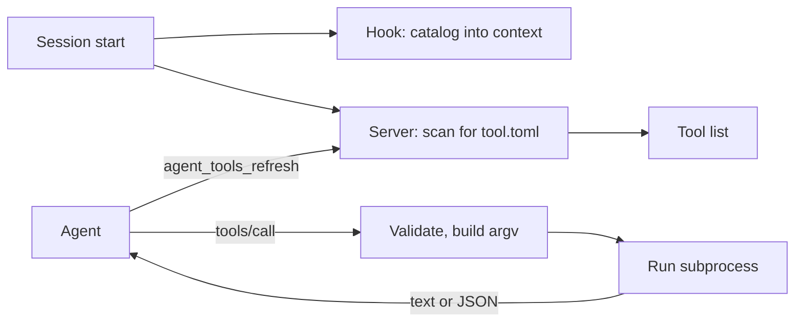

# agent-tools

**To add a tool, read [ADD-A-TOOL.md](ADD-A-TOOL.md) (five steps).** This README is the full reference.

`agent-tools` is one MCP server that exposes local scripts as tools. Each tool declares itself in a `tool.toml` manifest next to its script, anywhere in the project. You keep no central list. The server uses only the Python 3.11+ standard library.



## Discovery

| When | What happens |
|---|---|
| Session start | The server scans once and loads the tools. The `SessionStart` hook writes a short catalog (each name and its first sentence) into the context |
| On demand | The built-in tool `agent_tools_refresh` scans again. If the tools changed, it sends `notifications/tools/list_changed` |

If you add a manifest during a session, the new tool appears only after a refresh. The prefix `agent_tools_` is reserved for built-in tools.

## Where tools live

A manifest is a file named `tool.toml` at any depth below a search root.

| Order | Search root | Use it for |
|---|---|---|
| 1 | `<agent-tools>/tools/` | Tools that ship with agent-tools |
| 2 | `<project>/` | Tools of one repository, in any folder |
| 3 | Each path in `paths` of `<project>/.claude/agent-tools.toml`, then of `~/.claude/agent-tools.toml` | Custom folders for one project, or for all projects |
| 4 | Each path in `AGENT_TOOLS_PATH` | Custom folders for one machine or one environment |
| 5 | Each other installed plugin | Tools that a plugin ships, for example `notion-context` |

### Installed plugins

A plugin can ship a `tool.toml` anywhere in its folder, and its tools are available in every project. agent-tools scans two places for installed plugins:

| Order | Place | Host that uses it |
|---|---|---|
| 1 | The folders next to the agent-tools folder | Each host. The desktop app keeps its plugins only here. |
| 2 | `~/.claude/plugins/` (`cache/` and `synced/`) | The CLI and cloud sessions |

- If a plugin name is in place 1, agent-tools does not scan place 2 for that name.
- Claude Code keeps old versions and old generations on disk. agent-tools uses only the newest copy of each plugin (newest `.claude-plugin/plugin.json`).
- agent-tools does not scan itself again. Its own tools are in `tools/`.
- agent-tools cannot see if a plugin is disabled. A disabled plugin that is still installed gives its tools. To stop this, uninstall the plugin, or set `plugins = false`.
- `CLAUDE_CONFIG_DIR` replaces `~/.claude` if it is set.

### Custom paths (`agent-tools.toml`)

```toml
# <project>/.claude/agent-tools.toml or ~/.claude/agent-tools.toml
paths = ["../shared-tools", "~/my-tools"]   # relative to the folder of this file; ~ is permitted
plugins = true                              # false: do not scan the installed plugins
```

| Key | Default | Rule |
|---|---|---|
| `paths` | `[]` | List of folders. Each folder is a search root |
| `plugins` | `true` | If one of the two files sets `false`, agent-tools does not scan the installed plugins |

The server reads both files again on each `agent_tools_refresh`. `check` shows the errors in them.

### Scan rules

- In a git work tree, `git ls-files` finds the manifests. It includes new files and obeys `.gitignore`. Elsewhere, a folder walk finds them, 10 levels deep maximum.
- Both skip hidden folders and `node_modules`, `bin`, `obj`, `dist`, `build`, `target`, `venv`, `__pycache__`, `Library`, `Temp`, `Logs` and `fixtures`. Add folder names to `AGENT_TOOLS_EXCLUDE`.
- `<project>` is `$CLAUDE_PROJECT_DIR` if it is set, else the server's current folder.
- `AGENT_TOOLS_PATH` and `AGENT_TOOLS_EXCLUDE` use the path separator of the system (`:` on Linux and macOS, `;` on Windows).
- If two manifests declare the same tool name, the first one wins. `check` shows the conflict.

## Manifest (`tool.toml`)

One manifest can declare one or more tools. `[defaults]` gives shared values to each `[[tool]]` entry.

```toml
[defaults]
command = ["python3", "-m", "notion_context"]   # argv, never a shell string
env = ["NOTION_TOKEN", "NOTION_CONTEXT_CONFIG?"] # "?" = optional
timeout = 120

[[tool]]
name = "notion_get"
description = """Read one Notion page by its key, with its related pages, as one document. \
Use it before you work on a spec or an issue. Returns Markdown."""
args = ["get", "{key}", "--doc={doc?}", "--format={format}"]
[tool.input]
key    = { type = "string", required = true, description = "Page key, for example SPEC-1" }
doc    = { type = "string", description = "Document recipe" }
format = { type = "string", enum = ["md", "json"], default = "md" }
```

### Tool keys

| Key | Required | Default | Rule |
|---|---|---|---|
| `name` | Yes | None | `snake_case`, 48 characters maximum, unique |
| `description` | Yes | None | 20–1024 characters. What, when, what it returns |
| `command` | Yes | None | List. `python3`, `python` or `py` use the server's Python |
| `args` | Yes | None | List of argv templates (see below) |
| `input` | No | None | Table of inputs (see below) |
| `output` | No | `text` | `text` or `json` (JSON object → `structuredContent`) |
| `effect` | No | `read` | `read` or `write`. The server hides write tools |
| `env` | No | None | Variable names to pass. `NAME?` is optional |
| `timeout` | No | `60` | Seconds |
| `cwd` | No | `.` | Relative to the manifest folder |
| `enabled` | No | `true` | `false` hides the tool |

A `command` that starts with `./` is relative to the manifest folder.

### Input keys

| Key | Rule |
|---|---|
| `type` | `string`, `integer`, `number`, `boolean` or `array` |
| `description` | Required, unless `enum` is set |
| `required` | `true` or `false` |
| `enum` | List of permitted values |
| `default` | Used when the agent gives no value |
| `items` | Item type of an `array`. Default `string` |

Each input must appear in `args`, and each placeholder in `args` must be an input. `check` reports a mismatch.

### Argv templates

Each element of `args` has one placeholder maximum.

| Template | Value | Result |
|---|---|---|
| `"{key}"` | `"SPEC-1"` | `SPEC-1`. Error if no value |
| `"--doc={doc?}"` | None | The element is removed |
| `"--where={where*}"` | `["A=1", "B=2"]` | `--where=A=1 --where=B=2` |
| `"{verbose\|--verbose}"` | `true` | `--verbose`. Removed if `false` |

A value in a standalone placeholder (`"{key}"`, or an item of `"{items*}"`) cannot start with `-`. This stops option injection. It also rejects a negative number such as `-5`. Attach the value to its flag (`"--n={n}"`) if it can start with `-`.

The modifier must agree with the input type: `*` only for `array`, `|` only for `boolean`, and no modifier or `?` only for the other types.

## What the server does for each call

1. Validates the arguments against the input schema. If they are not valid, it returns `isError` with the reason.
2. Builds argv as a list and runs it with no shell.
3. Passes only a base environment (`PATH`, `HOME`, proxy and certificate variables) and the `env` names of the tool. It also sets `CLAUDE_PROJECT_DIR` to the project folder, because the tool runs in its manifest folder.
4. Stops the process after `timeout`.
5. Cuts stdout to 100 KB and stderr to 8 KB.
6. If the exit code is not 0, returns `isError` with stderr.

## Trust

The server runs the commands that the manifests in the opened project declare. Treat a `tool.toml` like a script in the repository:

- Enable the plugin only for repositories that you trust. A manifest in a cloned repository can run any program that is on `PATH`.
- `effect = "read"` is what the manifest says about itself. The server does not verify it.
- The `SessionStart` catalog puts tool descriptions from the repository into the session context. Do not trust the text of a manifest that you did not read.
- `cwd` and a `./` command are relative to the manifest folder, and can use `..`.
- A manifest in an installed plugin, or in a folder from `agent-tools.toml` or `AGENT_TOOLS_PATH`, runs in every project. Install only plugins that you trust.

## Install

The plugin starts the server automatically. Each start needs Python 3.11 or later.

| Start | Command | Shell |
|---|---|---|
| MCP server (`.mcp.json`) | `python server/main.py serve` | None. On Windows, Claude Code starts it as a Windows process. |
| `SessionStart` catalog (`hooks/hooks.json`) | `sh server/run.sh catalog` | `sh`. On Windows, Claude Code runs hooks in Git Bash. |

- `python` must be on `PATH`. On Windows, `python3` is often the Microsoft Store stub, so the server does not use it.
- `run.sh` uses the first Python 3.11+ on `PATH` (`python3`, `python`, `py`).

Plugins cannot ship environment values. Set each variable that a tool declares, for example `NOTION_TOKEN`, in `~/.claude/settings.json` (`env`) or in the cloud environment settings.

## Commands

Run them from the project folder:

```sh
python3 <plugin>/server/main.py check                 # validate manifests, show the search roots
python3 <plugin>/server/main.py list                  # tools that the server exposes
python3 <plugin>/server/main.py catalog               # the text that the SessionStart hook writes
python3 <plugin>/server/main.py call notion_get '{"key":"SPEC-1"}'
```

| Option | Use |
|---|---|
| `--root PATH` | Add a search root. You can repeat it |
| `--plugin-root PATH` | Use a different agent-tools folder. Its `tools/` is root 1. The tests use it |
| `--project PATH` | Set the project folder |
| `--allow-write` or `AGENT_TOOLS_ALLOW_WRITE=1` | Also expose `effect = "write"` tools |

## Refresh: client support

`agent_tools_refresh` needs a client that acts on `list_changed`.

| Client | `list_changed` | If not supported |
|---|---|---|
| Claude Code 2.1.0 or later | Yes | Not applicable |
| Cursor | Not reliable | Restart the server |
| Others | Unknown | Reconnect (`/mcp`) or start a new session |

With tool search, Claude Code loads only the tool names at start. The full description loads when the agent searches. Thus, the description must contain the words that an agent searches for.

## Tests

```sh
cd server && python3 -m unittest discover -s tests
```

The tests start the real server as a subprocess. They call a fixture tool, add a manifest and call `agent_tools_refresh`, and check the git scan with `.gitignore`.
