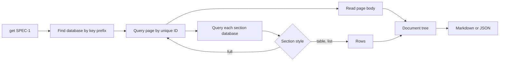
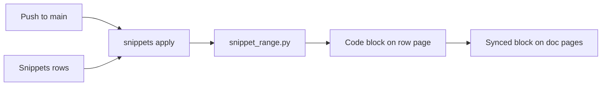

# notion-context

`notion-context` is the structured Notion tool set for agents and CI. It has two parts:

- **Context:** reads Notion pages and their related pages, and writes one Markdown or JSON document for an agent. A TOML config defines the databases and the document types, so a new page type needs no code change.
- **Snippets:** keeps native Notion code blocks equal to code in a GitHub repo. See [Snippets](#snippets).

The tool uses only the Python standard library (Python 3.11 or later).

## Why a script and not the MCP

A spec is a graph of pages. The Notion MCP and the REST API return one part of that graph for each call. The agent then must join the parts in its context. The script joins the parts in code.

Cost to read one spec:

| Path | Agent calls | Agent tokens | Repeatable |
|---|---|---|---|
| MCP, through linked views | ~7 | ~7,000 | No |
| MCP, through relations | ~4 | ~1,700 | No |
| `notion-context get SPEC-1` | 1 | ~450 | Yes |

Linked views ("filtered to this page") are for people. The API cannot read their filters. The script reads the relation properties, which hold the same links.

## How it works



## Prepare

1. Make an internal integration in Notion: **Settings → Connections → Develop or manage integrations**.
2. Share each database with the integration: **••• → Connections → Add connection**.
3. Set the token in the environment: `export NOTION_TOKEN=ntn_...`. Do not commit the token.
4. Copy `notion-context.example.toml` to `notion-context.toml` in the root of your project. Change the database ids. Do not commit this file if the ids are private.
5. Run `python3 -m notion_context check` from this folder, with `CLAUDE_PROJECT_DIR` set to your project.

The tool finds its config in this order:

| Order | Path |
|---|---|
| 1 | `--config PATH` |
| 2 | `$NOTION_CONTEXT_CONFIG` |
| 3 | `./notion-context.toml` |
| 4 | `$CLAUDE_PROJECT_DIR/notion-context.toml` |

The plugin keeps the code. Each project keeps its own config. agent-tools sets `CLAUDE_PROJECT_DIR` for each call, so path 4 is the usual path.

Run the tool from this folder. If you run it from a different folder, add this folder to `PYTHONPATH`.

## Commands

| Command | Result |
|---|---|
| `get SPEC-1` | Page and sections, default document |
| `get SPEC-1 --doc spec-brief` | The same page, with a different document |
| `get SPEC-1 --format json --out spec.json` | JSON tree in a file |
| `query issues --where Status=Ready --where Area=rules` | Rows that match all filters |
| `query issues --where Status=!Done --columns Key,Title` | Negated filter, selected columns |
| `schema issues` | Property names, types and options |
| `check` | Compares the config with the live schemas |
| `snippets plan` | Lists the Snippets rows that change. See [Snippets](#snippets) |

Global options: `--config PATH` (or `NOTION_CONTEXT_CONFIG`) and `--stats` (API call count on stderr).

`check` returns exit code 1 if it finds an error. Other errors return exit code 2.

## Config

### Databases

```toml
[databases.issues]
id = "070982194a904e4a8ea9de8c3b303b34"
key = "Key"          # unique_id property; gives keys such as ISS-12
document = "issue"   # default document for `get ISS-12`
# prefix = "ISS"     # optional; read from the schema if not set
```

A database with no `key` can be a section source, but `get` cannot find its pages.

### Documents

A document is one output type. It has fields, an optional page body and sections.

```toml
[documents.spec]
database = "specs"
fields = ["Status", "Goal"]   # ["*"] for all properties
body = true                   # page body as Markdown

[[documents.spec.sections]]
title = "Issues"
database = "issues"
backlink = "Spec"             # relation on issues that points to the spec
filter = ["Status=!Done"]     # optional, AND
columns = ["Key", "Title", "Status"]
style = "table"               # table | list | full
# document = "issue"          # with style full: each item as an issue document
```

| Section key | Use |
|---|---|
| `backlink` | Section relation to the root; 1 query |
| `relation` | Root relation; 1 call for each item |
| `style = "full"` | Each item as a full document |

Full documents nest to `settings.max_depth` levels.

Set exactly one of `backlink` and `relation`. Use `backlink` when a two-way relation exists, because it needs fewer calls.

A page that was already visited in the same tree shows as one line. Thus, a cycle such as spec → issue → spec stops.

### Settings

| Key | Values | Default |
|---|---|---|
| `child_databases` | `skip`, `link` (one line), `rows` (all rows) | `link` |
| `max_depth` | Levels of `full` sections | `3` |

Linked views in a page body are always skipped.

## Add a new page type

1. Run `schema <database id>` to see the property names.
2. Add a `[databases.<alias>]` entry.
3. Add a `[documents.<name>]` entry with its sections.
4. Run `check`, then `get <KEY>`.

## Body conversion

| Notion block | Markdown |
|---|---|
| Headings, toggle headings | `#` headings, below the document heading |
| Lists, to-dos, toggles | Nested lists |
| Code, quote, callout, equation | Fence, `>` quote, `$$` block |
| Table | Pipe table |
| Bookmark, image, file, embed | Link |
| Child page | `- Subpage: <title>` |

The tool reads nested blocks recursively, to 8 levels. Mentions show as their plain text.

## Limits

- The Notion API allows about 3 requests a second. On HTTP 429 or 5xx, the client waits (`Retry-After`, or 1, 2, 4… seconds) and tries again, 5 times maximum.
- Each `full` item and each nested block costs more requests. For large specs, use `table` or `list` sections.
- The API version is `2022-06-28`. Only the `snippets` command writes to Notion.

## Snippets

A row in a Notion Snippets database selects a method or a line range in a GitHub file. A GitHub Action in the code repo writes that code into the code block of the row page. Notion search, Notion AI and the Notion API read the code as text. The skill [`skills/notion-snippets/SKILL.md`](skills/notion-snippets/SKILL.md) tells an agent how to add a snippet.



| File | Purpose |
|---|---|
| `notion_context/snippet_range.py` | Finds the lines of a method or a line range |
| `notion_context/snippets.py` | Reads the rows, writes the code blocks and the row status |
| `workflow/notion-snippets.yml` | Workflow for the code repo |

### Prepare a code repo

1. Make an internal Notion integration with "read content" and "update content". Connect it to the page of the Snippets database.
2. Copy `workflow/notion-snippets.yml` to `.github/workflows/` in the code repo. The workflow checks out this plugin from MgCohen/claude-plugins, so the code repo has no copy of the tools.
3. Set the secrets and variables:

```bash
gh secret set NOTION_TOKEN -R owner/repo
gh secret set AUTOMATION_APP_KEY -R owner/repo < private-key.pem
gh variable set AUTOMATION_APP_ID -R owner/repo -b <app-id>
gh variable set NOTION_SNIPPETS_DATABASE -R owner/repo -b <database-id>
```

`AUTOMATION_APP_ID` and `AUTOMATION_APP_KEY` belong to the `mgcohen-automation` GitHub App. The App token can read MgCohen/claude-plugins. The optional variable `NOTION_TOOLS_REF` selects a branch or tag of the plugin repo. The default is `main`.

### Snippets database

| Property | Type | Written by |
|---|---|---|
| Name | Title | Person or agent |
| File | URL | Person or agent |
| Method | Text | Person or agent |
| Overload, Lines before, Lines after | Number | Person or agent |
| Start line, End line | Number | Person or agent, and the Action when the range moves |
| Status, Message, Hash, Region | Select, text | Action |

### Workflow triggers

| Trigger | Mode | Result |
|---|---|---|
| Push to `main` | apply | Writes the blocks that changed |
| Pull request | plan | Lists the blocks that the merge changes |
| Nightly | apply | Gives code to rows added in Notion |
| Manual | plan, apply or force | `force` writes all blocks |

Pull requests from forks and from Dependabot do not run the job, because they get no secrets.

A new error fails the run. The Action writes Status Error and the reason on the row. Later runs show the same error as "error (known)" and do not fail.

### Snippet limits

- The method search reads C-like code with a small parser. It does not read JavaScript regex literals with braces, tuple return types, TypeScript class fields without a modifier, or arrow functions without a semicolon.
- A method range starts at the declaration line. Use Lines before for attributes and doc comments on the lines above.
- An overload is selected by its position in the file, not by its signature.
- A File link with a branch reads the commit that the Action runs on. Only a commit in the link selects other code.
- A line range follows the code only if Start line and End line both have a value. It does not follow a file rename.
- The code of one snippet can have a maximum of 100,000 characters.

## Agent tool (MCP)

`tool.toml` declares two MCP tools, `notion_get` and `notion_query`. This folder is a plugin of its own. agent-tools scans the installed plugins, so the tools are available in every project where both plugins are installed. Set `NOTION_TOKEN` in the client environment, and put `notion-context.toml` in the project root.

`tests/test_tool_manifest.py` builds the argv of each tool from the manifest and parses it with the real CLI parser. If a flag changes in one place only, the test fails.

## Tests

```sh
python3 -m unittest discover -s tests
```

The tests use an in-memory fake client. They do not use the network.
