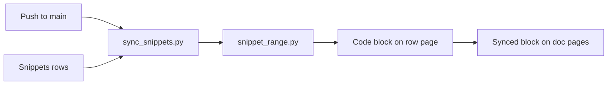

# notion-snippets

`notion-snippets` keeps native Notion code blocks equal to code in a GitHub repo. A row in a Notion Snippets database selects a method or a line range. A GitHub Action in the code repo writes that code into the code block of the row page. Notion search, Notion AI and the Notion API read the code as text.



## Files

| File | Purpose |
|---|---|
| `tools/snippet_range.py` | Finds the lines of a method or a line range |
| `tools/sync_snippets.py` | Reads the rows, writes the code blocks and the row status |
| `tools/test_snippet_range.py` | Tests: `python -m unittest test_snippet_range` in `tools/` |
| `workflow/notion-snippets.yml` | Workflow for the code repo |
| `skills/notion-snippets/SKILL.md` | Tells an agent how to add a snippet |

The tools use only the Python standard library (Python 3.12 or later).

## Prepare a code repo

1. Make an internal Notion integration with "read content" and "update content". Connect it to the page of the Snippets database.
2. Copy `tools/snippet_range.py` and `tools/sync_snippets.py` to `.github/notion-snippets/` in the code repo.
3. Copy `workflow/notion-snippets.yml` to `.github/workflows/` in the code repo.
4. Set the token and the database ID:

```bash
gh secret set NOTION_TOKEN -R owner/repo
```

```bash
gh variable set NOTION_SNIPPETS_DATABASE -R owner/repo -b <database-id>
```

## Snippets database

| Property | Type | Written by |
|---|---|---|
| Name | Title | Person or agent |
| File | URL | Person or agent |
| Method | Text | Person or agent |
| Overload, Lines before, Lines after | Number | Person or agent |
| Start line, End line | Number | Person or agent, and the Action when the range moves |
| Status, Message, Hash, Region | Select, text | Action |

## Workflow triggers

| Trigger | Mode | Result |
|---|---|---|
| Push to `main` | apply | Writes the blocks that changed |
| Pull request | plan | Lists the blocks that the merge changes |
| Nightly | apply | Gives code to rows added in Notion |
| Manual | plan, apply or force | `force` writes all blocks |

## Limits

- The method search reads C-like code with a small parser. It does not read JavaScript regex literals with braces, tuple return types, or arrow functions without a semicolon.
- An overload is selected by its position in the file, not by its signature.
- A line range does not follow a file rename.

## Open questions

- Copy the tools into each code repo, or call a reusable workflow from this repo?
