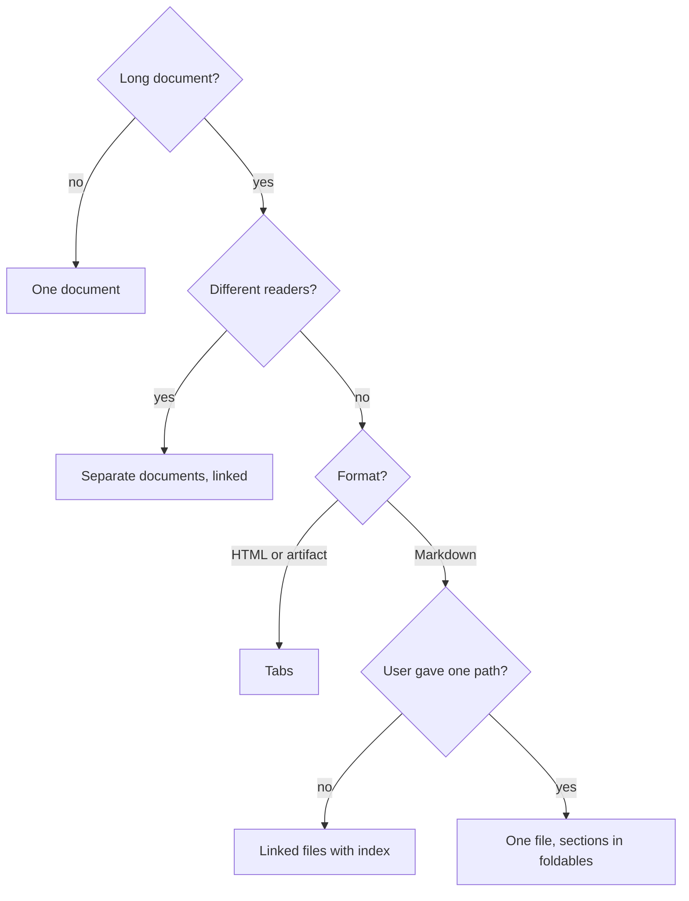

# Technical English: documents and layout

The core STE rules are in the output style (and in the subagent context). This file adds examples
and the rules for documents and artifacts. For a word that you are not sure about, read
`references/words.md`.

## Language examples

| Rule | Write | Do not write |
|---|---|---|
| Imperative | "Run the gate." | "You should run the gate." |
| Active voice | "The hook adds the context." | "The context is added." |
| Condition first | "If the gate fails, read the report." | "Read the report if it fails." |
| Noun clusters | "the report of the gate failure" | "gate failure report file path" |
| Approved words | "use", "start" | "utilize", "commence" |
| Code comments | "Returns the card index." | "This basically returns..." |

- Do not use synonyms for variety. Use "None" for no value and "forbidden" for not permitted.
- Do not use an abbreviation of a term in a label ("refs" for "references").
- Write list items and table cells of the same type in the same form.
- Warnings: start with a command, then give the risk.

## Visuals first

Write prose only for the parts that a visual cannot show.

| Content | Visual |
|---|---|
| Steps or states | Flow graph |
| Calls between functions or services | Call stack or sequence diagram |
| Parts and their dependencies | Dependency graph |
| Numbers, trends or comparisons | Chart |
| Items with the same attributes | Table |
| Code behavior or an API | Code snippet |

- **Replace, do not add.** When you add a visual, delete the prose that says the same thing.
- **Prose share:** outside code blocks, prose is 50% of the words maximum.
- If a diagram has less than 3 nodes or a table less than 3 rows, write one sentence.
- Give each visual a title that states its message.
- Snippets show only the lines that make the point.

## Limits

| Item | Limit | If longer |
|---|---|---|
| Table | 6 columns, 15 rows | Split by group, or use a tab |
| Table header | 3 words | None |
| Table cell | Fragment, 8 words, not empty | Put the sentence in the body text |
| Diagram | 3 to 10 nodes | Split by layer or by step |
| Chart | 5 series, 12 categories | Split the chart |
| Graph label | 4 words | None |
| List | 7 items, 2 levels | Use a table |
| Section | 300 words | Split into two sections |
| Heading interval | 250 words | Add a heading |
| Chat reply | 150 words (target) | Above 400 words: a file or an artifact |
| Document | 1,500 words, 7 top-level sections | Use the decision flow |

- Put the unit in the table header: "Size (KB)".
- Graph edge labels: one verb in the simple present ("sends", "reads").
- Labels use the key terms of the text, not synonyms.

## Document structure

- Start with a summary of 3 sentences maximum. Give the result or the decision first.
- Use 3 heading levels maximum.
- Give blocks of the same type the same structure (for example: Purpose, Path, Contains, Uses).
- All visible text follows STE: titles, buttons, tooltips, SVG labels and `aria-label` text.
- Do not refer to the session or the chat. The reader does not see it. Give the source name.

## Long documents: decision flow

Code blocks do not count in the length.

| Result | Rules |
|---|---|
| Tabs | 2 to 6 tabs. Tab names: 2 words maximum. First tab: summary and main visual. |
| Linked files | One folder. `README.md` index with summary, main visual and links. A link back to the index in each file. |
| One file | Keep the summary and the main visual open. Each section of more than 300 words in a foldable. |

**No repeats.** Give each fact one place. Other parts link to it. The index or the overview tab has
only the summary, the main visual and the links. A split does not add content.

## Foldables

Use a foldable for each item of a repeated segment: three or more items with the same structure,
for example layers, findings or endpoints.

- Title: the item name and one key fact: "Domain · VSA.Domain, Notes.Domain".
- Put a summary of all items (a table or a graph) before the foldables.
- Keep the foldables closed. Do not put the main message or a warning in a foldable.

| Format | Foldable |
|---|---|
| HTML or artifact | `
`, with "Open all" and "Close all" for 5 items or more |
| Markdown on GitHub or in a browser | `
` |
| Markdown in other editors | A heading for each item |

## Files and edits

- Edits: write your new sentences in STE. Do not rewrite other text, unless the user asks for an
  STE pass.
- STE pass: keep the meaning, the structure and the technical names. Then list the changes that
  could change the meaning.

## Before you deliver

Examine the full text against the core rules and this file. Look for: one term for each idea,
phrasal verbs, long sentences, prose that a visual can replace, the limits table, repeats and
references to the session. Fix each problem in the source.

## When not to apply it

- User text, quotes, error messages, log lines and code stay as they are.
- If the user asks for a different style for one output, use it for that output only.
- Non-English output: keep the principles, but do not translate the dictionary.
