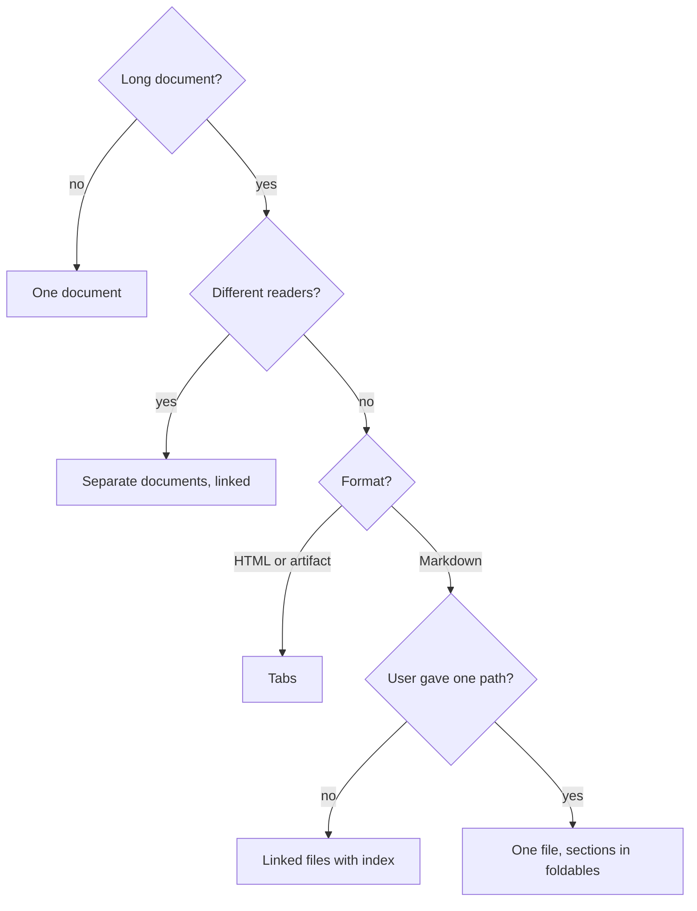

# Layout rules: visuals, tables, graphs and documents

These are house rules of this plugin. They are not part of ASD-STE100. They apply to all output
that is more than a short reply: documents, artifacts, pages, READMEs, reports and slides. The
language rules (words, terms, sentences) are in `SKILL.md`.

| Part | Sections |
|---|---|
| Start | Long documents: decision flow |
| Part 1: Elements | Visuals first, Tables, Graphs, Foldables |
| Part 2: Documents | Structure, Length limits, Tabs, Linked files, No repeats |

## Long documents: decision flow

A document is long if it has more than 1,500 words or more than 7 top-level sections. Code blocks
do not count.

| Result | Rules |
|---|---|
| Tabs | [Tabs](#tabs) |
| Linked files with index | [Linked Markdown files](#linked-markdown-files) |
| One file, sections in foldables | [Foldables](#foldables) |
| Separate documents | Link each document to the others |

All splits follow [No repeats](#no-repeats). A split does not add content.

## Part 1: Elements

### Visuals first

Use a visual before prose. Write prose only for the parts that a visual cannot show.

| Content | Visual |
|---|---|
| A sequence of steps or states | Flow graph |
| Calls between functions or services | Call stack or sequence diagram |
| Parts and their dependencies | Dependency graph |
| Numbers, trends or comparisons | Chart |
| Items with the same attributes | Table |
| Code behavior or an API | Code snippet |
| A command to run | Command block |

- **Replace, do not add.** When you add a visual, delete the prose that says the same thing.
- **Minimum size.** A diagram needs 3 nodes or more. A table needs 3 rows or more. If the content
  is smaller, write one sentence.
- **Prose share.** Outside code blocks, prose is 50% of the words maximum.
- Give each visual a title that states its message. Add one or two sentences only if necessary.
- Keep snippets short: the lines that show the point, not the full file.
- In a reply, a short table, list or snippet is also a visual.

### Tables

| Item | Limit |
|---|---|
| Columns | 6 maximum |
| Rows | 15 maximum |
| Header | Noun phrase, 3 words maximum |
| Cell | Fragment, 8 words maximum |

- Use a table when three or more items share two or more attributes.
- Put the unit in the header: "Size (KB)".
- If a cell needs a sentence, put the sentence in the body text.
- Do not put a fragment and a sentence in the same cell.
- Do not leave a cell empty. Write "None".
- If a cell lists more than three items, use a list below the table, or split the row.
- If a table has more than 15 rows, split it by group, or move it to its own tab.

### Graphs, charts and diagrams

| Item | Limit |
|---|---|
| Diagram nodes | 3 to 10 |
| Chart series | 5 maximum |
| Chart categories | 12 maximum |
| Label | 4 words maximum |

- Show one message in each graph. The title gives that message: "Cards in each zone after the
  draw step".
- Edge labels for actions: one verb in the simple present ("sends", "reads", "starts").
- Put labels on the data, not in a legend, when possible.
- Labels use the key terms of the text. They do not use synonyms.
- If a diagram has more than 10 nodes, split it by layer or by step.

### Foldables

Use a foldable for each item of a repeated segment. A repeated segment has three or more items with
the same structure, for example layers, findings or endpoints.

- The foldable title shows the item name and one key fact: "Domain · VSA.Domain, Notes.Domain".
- Put the summary of all items (a table or a graph) before the foldables. Keep it open.
- Do not put the main message or a warning in a foldable.
- Keep all foldables closed at the start.

| Format | Foldable | "Open all" and "Close all" |
|---|---|---|
| HTML or artifact | `
` and `
` | If 5 items or more |
| Markdown on GitHub or in a browser | `
` and `
` | None |
| Markdown in other editors | A heading for each item | None |

## Part 2: Documents

### Structure

- Start with a summary of 3 sentences maximum. Give the result or the decision first.
- Use 3 heading levels maximum.
- Use the same structure for blocks of the same type (for example: Purpose, Path, Contains, Uses).
- Do not refer to the session, the chat or "the briefing". The reader does not see the session.
  Give the name of the source.

### Length limits

| Item | Limit | If longer |
|---|---|---|
| Chat reply | 150 words (target) | Above 400 words: artifact or file |
| Document | 1,500 words, 7 top-level sections | Use the decision flow |
| Section | 300 words | Split into two sections |
| Heading interval | 250 words | Add a heading |
| List | 7 items, 2 levels | Split the list, or use a table |

### Tabs

Use tabs for a long HTML document or artifact with one type of reader.

- Use 2 to 6 tabs. If you need more, use separate documents.
- The first tab is the overview: the summary and the main visual.
- Give each tab a noun phrase of 2 words maximum, for example "Overview", "Rules", "Details".
- Long code examples can go in a tab of their own.

### Linked Markdown files

Markdown has no tabs. Use linked files for a long Markdown document when the user did not give one
path.

1. Put all files in one folder.
2. Add an index file (`README.md`) with the summary, the main visual and a link to each file.
3. Give each file one topic.
4. Add a link back to the index at the top of each file.

If the user gave one path, use one file. Keep the summary and the main visual open. Put each
section of more than 300 words in a foldable.

### No repeats

These rules apply to tabs, linked files, separate documents and foldables.

- Give each fact one place only. Other parts link to that place. They do not copy it.
- The index or the overview tab has only the summary, the main visual and the links.
- A split does not add content. Split the content that you have.
- Put a warning or a status note one time, in the overview.
- Do not repeat a table, a diagram or a list in a second part. Link to the first one.
