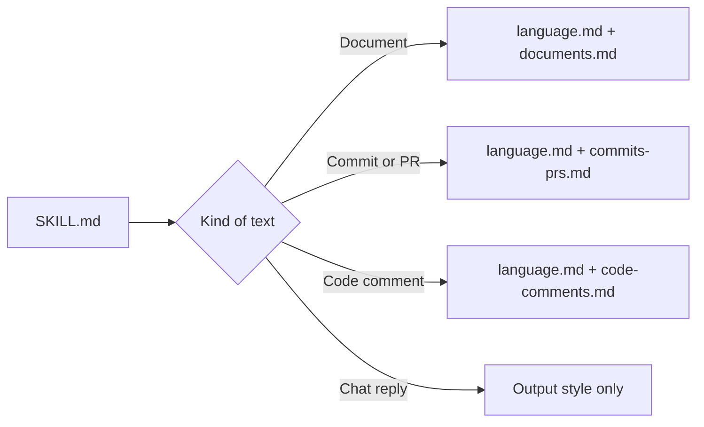

# Writing (ASD-STE100)

This plugin makes Claude write in ASD-STE100 Simplified Technical English (STE). It also gives
content rules for each kind of text: documents describe the current state, and commits and PRs
record the changes.

## Parts

Each rule is in one file that Claude reads.

| Part | File | When it loads | Contains |
|---|---|---|---|
| Output style | `output-styles/technical-english.md` | Always (forced) | Core language rules |
| Router skill | `skills/writing/SKILL.md` | Before files, commits, PRs | Kind of text, place of each fact |
| Language | `skills/writing/language.md` | For all kinds | Examples, edit rules |
| Documents | `skills/writing/documents.md` | Documents, artifacts | Current state, visuals, limits, layout |
| Commits and PRs | `skills/writing/commits-prs.md` | Commits, PRs | Change record |
| Code comments | `skills/writing/code-comments.md` | Comments, docstrings | Comment rules |
| Word list | `skills/writing/words.md` | When necessary | Word substitutions |
| Hooks | `hooks/hooks.json` | See the hook table | Short pointers |



| Hook | Text |
|---|---|
| UserPromptSubmit | One-line reminder |
| SubagentStart | The output style rules, from `hooks/subagent-start.sh` (subagents do not get the output style) |
| PostToolUse (`Write` of `.md`, `.html`, `.txt`) | One-line check |
| PostToolUse (`Artifact`) | One-line check |

The hooks use `cat` on prepared JSON files, and `sh` with `awk` for the subagent rules. They work
on macOS, Linux and Windows (Git Bash).

## Change the rules

| To change | Edit |
|---|---|
| Core language rules | `output-styles/technical-english.md` (subagents get the change automatically) |
| Which file loads for a kind of text | `skills/writing/SKILL.md` |
| Rules for one kind of text | The file of that kind in `skills/writing/` |
| Words | `skills/writing/words.md` |
| Other hook text | `hooks/context/*.json` |

To add a kind of text, add a file in `skills/writing/` and a row in the table of `SKILL.md`.

## Install

The plugin is in the `MgCohen/claude-plugins` marketplace. Enable `writing` in that marketplace
on claude.ai. claude.ai syncs it to each Claude Code session of this account.

For a local test, load the folder directly:

```bash
claude --plugin-dir ./plugins/writing
```

## House limits

| Item | Plugin | ASD-STE100 |
|---|---|---|
| Procedure sentence | 15 words | 20 words |
| Descriptive sentence | 20 words | 25 words |
| Paragraph | 4 sentences | 6 sentences |

The rules are a summary of ASD-STE100, not the standard. Get the full dictionary from
asd-ste100.org.
