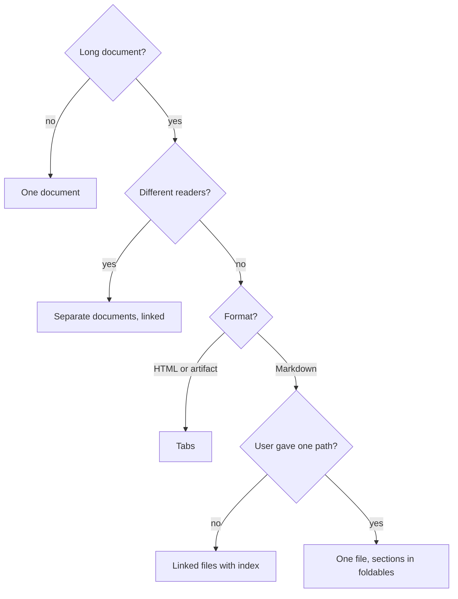

# Documents and artifacts

These rules apply to documents, artifacts, READMEs, reports and slides.

## Current state only

A document describes its subject as it is now. Write for a reader who never saw the session, the
chat or an earlier version of the document.

| Do not write in the body | Do this |
|---|---|
| "We removed the bulk delete endpoint." | Delete the endpoint from the document. Put the change in the commit or PR. |
| "The API now returns 404." | "The API returns 404." |
| "Instead of the old queue, X uses Y." | "X uses Y." |
| "We decided not to support bulk delete." | Under "Non-goals": "No bulk delete. Reason: audit trail." |
| "TBD: we still discuss the retry limit." | Under "Open questions": "Retry limit: 3 or 5?" |

- When the subject changes, rewrite or delete each sentence that the change makes false.
- Do not use change words in the body: "now", "no longer", "new", "old", "updated", "removed",
  "instead of", "we decided".
- A "Non-goals" item is a rule with a reason. It is not a record of a change.
- An "Open questions" item is an open question. When it is decided, put the answer in the body
  and delete the item.
- Do not refer to the session or the chat. Give the source name.

## Visuals first

Write prose only for the parts that a visual cannot show.

| Content | Visual |
|---|---|
| Steps or states | Flow graph |
| Calls between functions or services | Call stack or sequence diagram |
| Parts and their dependencies | Dependency graph |
| Numbers, trends or comparisons | Chart |
| Items with the same attributes | Table |
| Code behavior or an API | Code snippet |

- **Replace, do not add.** When you add a visual, delete the prose that says the same thing.
- **Prose share:** outside code blocks, prose is 50% of the words maximum.
- If a diagram has less than 3 nodes or a table less than 3 rows, write one sentence.
- Give each visual a title that states its message.
- Snippets show only the lines that make the point.

## Limits

| Item | Limit | If longer |
|---|---|---|
| Table | 6 columns, 15 rows | Split by group, or use a tab |
| Table header | 3 words | None |
| Table cell | Fragment, 8 words, not empty | Put the sentence in the body text |
| Diagram | 3 to 10 nodes | Split by layer or by step |
| Chart | 5 series, 12 categories | Split the chart |
| Graph label | 4 words | None |
| List | 7 items, 2 levels | Use a table |
| Section | 300 words | Split into two sections |
| Heading interval | 250 words | Add a heading |
| Chat reply | 150 words (target) | Above 400 words: a file or an artifact |
| Document | 1,500 words, 7 top-level sections | Use the decision flow |

- Put the unit in the table header: "Size (KB)".
- Graph edge labels: one verb in the simple present ("sends", "reads").
- Labels use the key terms of the text, not synonyms.

## Structure

- Start with a summary of 3 sentences maximum. Give the result or the decision first.
- Use 3 heading levels maximum.
- Give blocks of the same type the same structure (for example: Purpose, Path, Contains, Uses).
- All visible text follows STE: titles, buttons, tooltips, SVG labels and `aria-label` text.
- If the document has "Non-goals" or "Open questions", put them at the end.

## Long documents: decision flow

Code blocks do not count in the length.

| Result | Rules |
|---|---|
| Tabs | 2 to 6 tabs. Tab names: 2 words maximum. First tab: summary and main visual. |
| Linked files | One folder. `README.md` index with summary, main visual and links. A link back to the index in each file. |
| One file | Keep the summary and the main visual open. Each section of more than 300 words in a foldable. |

**No repeats.** Give each fact one place. Other parts link to it. The index or the overview tab has
only the summary, the main visual and the links. A split does not add content.

## Foldables

Use a foldable for each item of a repeated segment: three or more items with the same structure,
for example layers, findings or endpoints.

- Title: the item name and one key fact: "Domain · VSA.Domain, Notes.Domain".
- Put a summary of all items (a table or a graph) before the foldables.
- Keep the foldables closed. Do not put the main message or a warning in a foldable.

| Format | Foldable |
|---|---|
| HTML or artifact | `
`, with "Open all" and "Close all" for 5 items or more |
| Markdown on GitHub or in a browser | `
` |
| Markdown in other editors | A heading for each item |

## Check list

- Read each sentence. If it only makes sense to a reader of an earlier version, delete or rewrite it.
- No change words in the body. No references to the session.
- Prose that a visual can replace. The limits table. Repeats.
